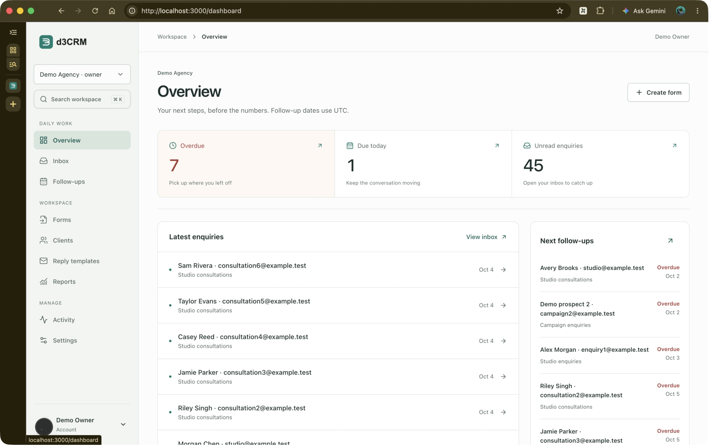
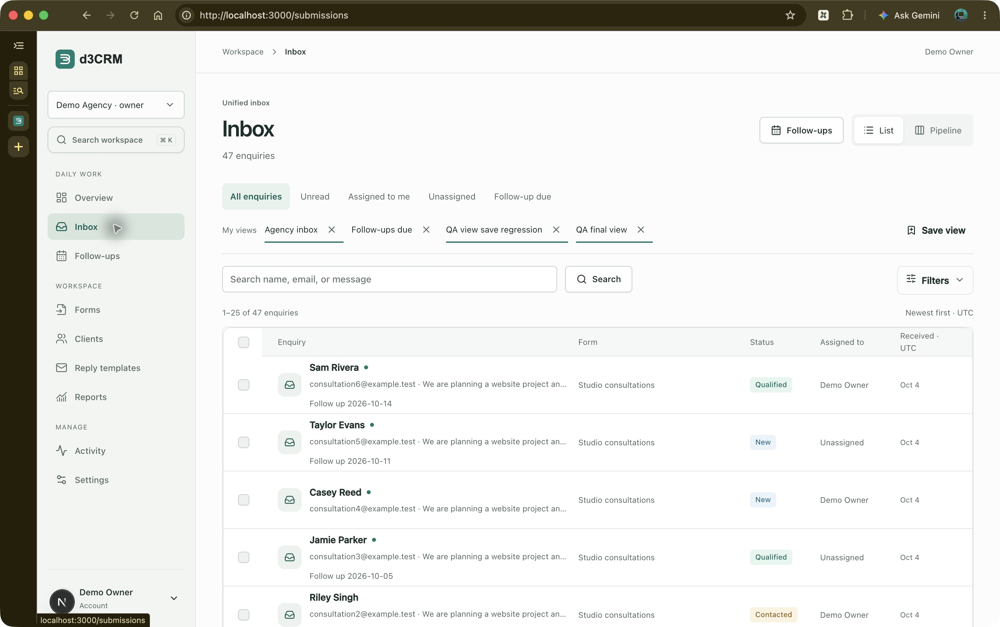
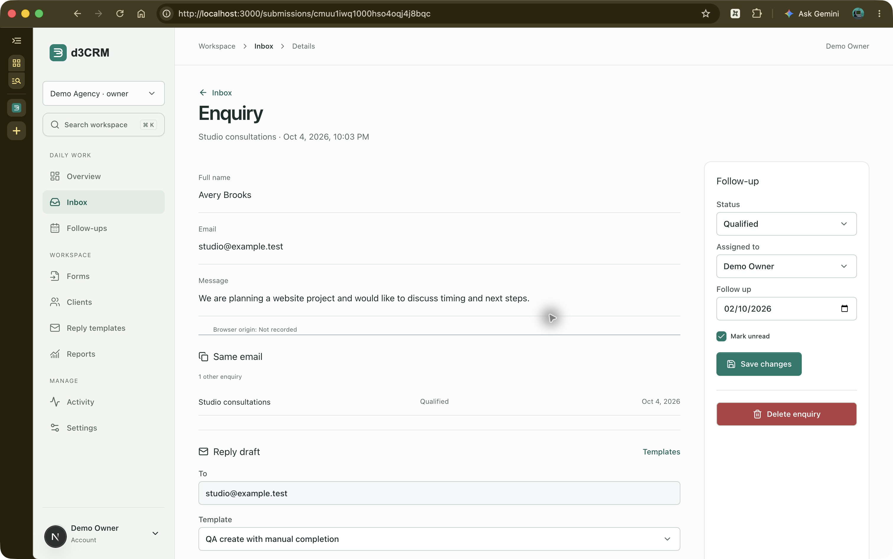
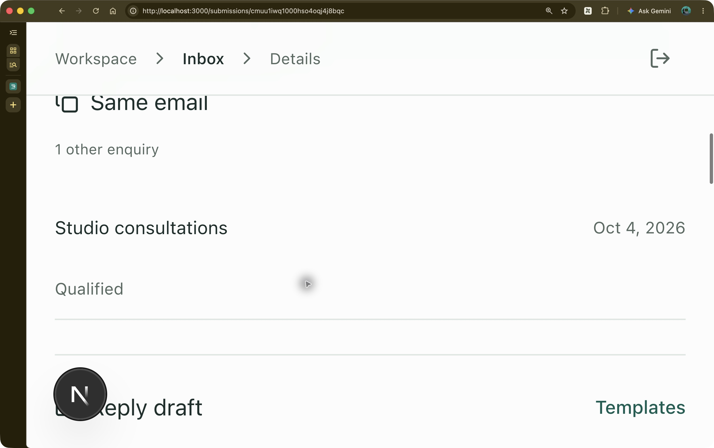
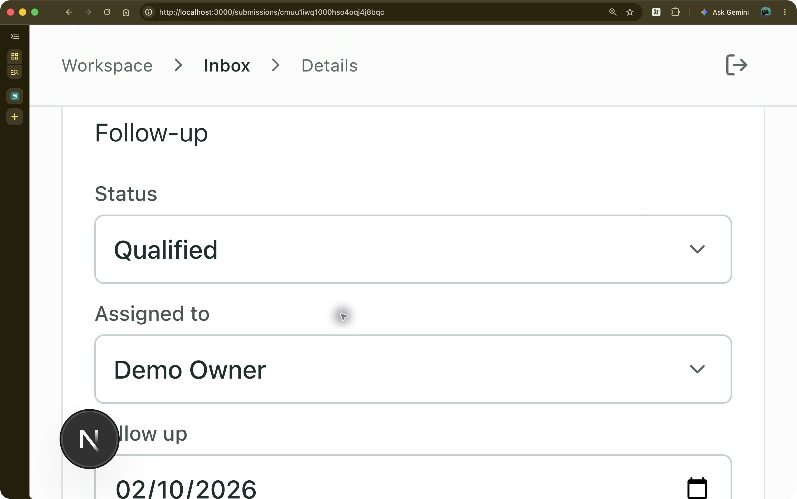
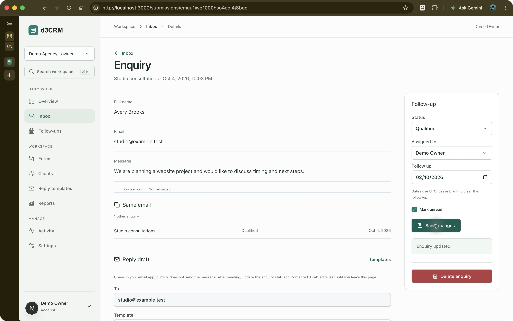

# Enquiry workflow review — 14 October 2026

Reviewed the updated `main` at `b006061`, after discarding previous local changes and pulling. Scope: overview → inbox → enquiry answers, follow-up controls, and reply draft. Goal: identify the next enquiry, understand it, and plan a response without losing track of edits.

All screenshots were captured in this run using Chrome computer use, saved and reopened for inspection. The in-app browser was unavailable. The preview uses the isolated local `d3crm_security_test` database and fictional demo records.

## 1. Overview — healthy

Daily priorities already foreground overdue work, today's follow-ups, and unread enquiries. The latest pull makes the next action clear and places follow-ups before reporting. No additional change needed in this pass.

## 2. Inbox — healthy, one remaining opportunity

Quick views, search, list/pipeline switching, and result counts are discoverable. Follow-up dates in rows are shown as raw dates rather than explicit overdue/today signals. A later improvement could add those signals using the existing UTC convention, while retaining text labels so color is never the only cue.

## 3. Enquiry detail — improved

The desktop shows answers and follow-up controls together, but narrow reflow previously placed every reply field, note, source detail, and activity entry before the controls. Keyboard and assistive-technology reading order followed that same long route. Reply draft behavior and the UTC convention were also unexplained at the point of use.

Implemented:

- Place follow-up controls immediately after answers in document order, ahead of related enquiries, the reply draft, and history. Retain the existing two-column desktop layout; use a single column below 600 CSS pixels.
- Give answers and follow-up areas accessible names.
- Explain UTC dates and how to clear a follow-up beside the date field, connected through `aria-describedby`.
- Show unsaved-edit feedback through a live status message; remove it after a successful save.
- Explain that replies open in the user's email app, sending is external, status must be updated after sending, and draft edits do not persist after navigation.
- Keep the desktop follow-up panel at its content height instead of stretching alongside the entire history.

## Validation and limits

Type checking and ESLint pass. All 44 unit tests pass. In Chrome, changing the unread checkbox displayed the unsaved message; restoring its original value and saving produced “Enquiry updated.” and removed the unsaved message. No external email was sent. Desktop before/after images were compared together; the answer area and existing visual language remain consistent.

Narrow layout was checked at 300% browser zoom, which activates the single-column breakpoint in this window. This is a reflow check, not a physical phone test. The narrow screenshots show successive viewport sections rather than full-page captures. The automated Playwright UI suite, screen-reader announcements, measured color contrast, and every workspace route were not checked. This review does not establish full accessibility compliance.

The next useful improvement is explicit overdue/today labels in inbox rows; it was left outside this focused enquiry-detail pass.
